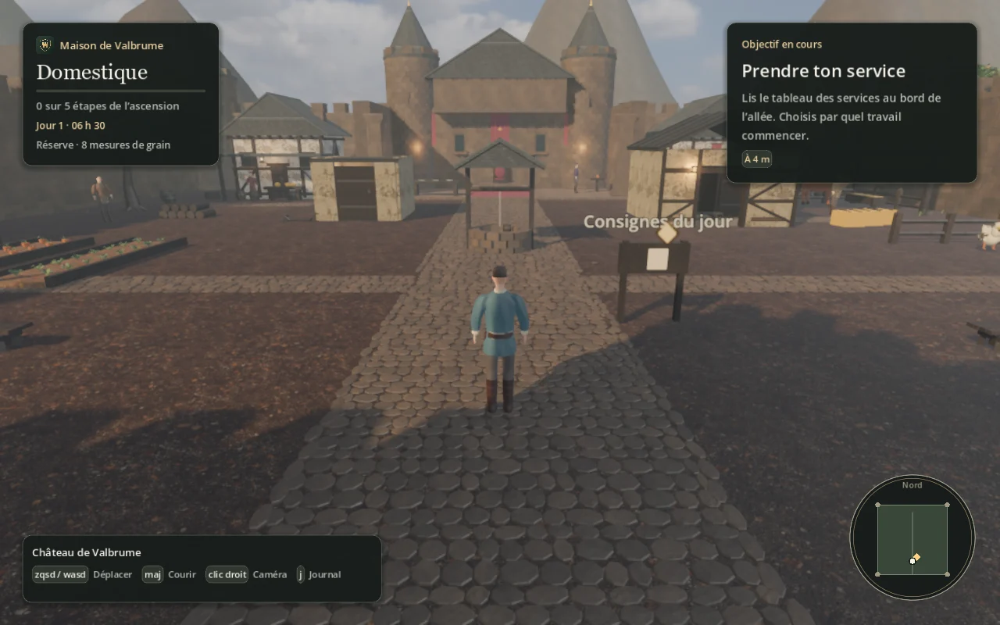
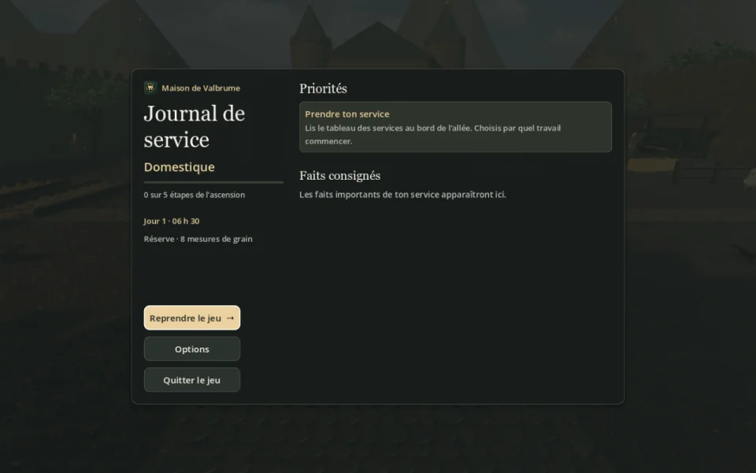
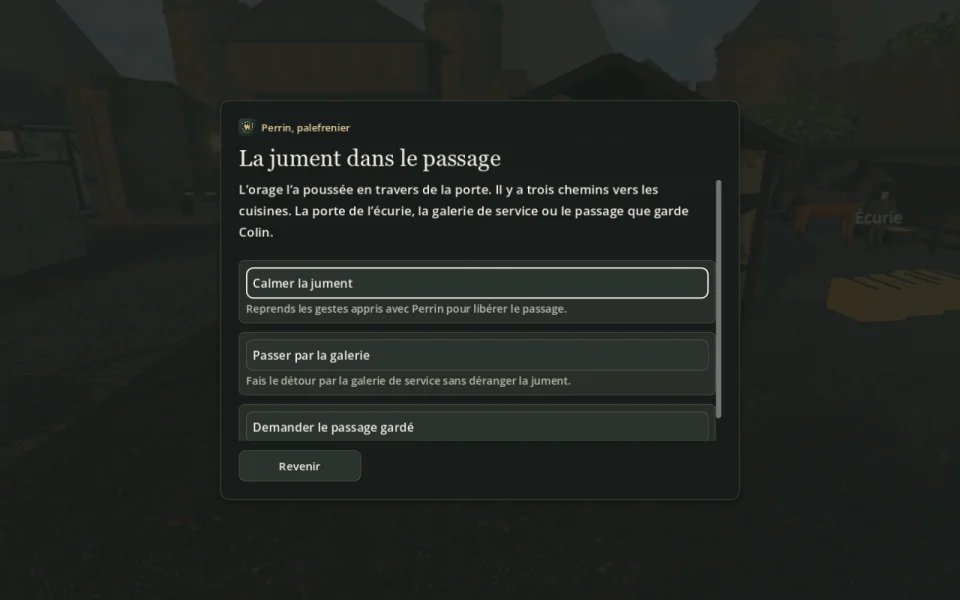

<div align="center">
  
  <h1>Les Clefs de Valbrume</h1>
  <p>Un RPG médiéval solo, en français.</p>
  <p>
    <a href="https://github.com/remimenguy/les-clefs-de-valbrume/releases/latest"><strong>Télécharger sur Mac</strong></a>
    · <a href="#depuis-les-sources">Lancer depuis les sources</a>
    · <a href="#captures">Captures</a>
  </p>
</div>



Tu commences comme domestique, avec des poules à nourrir, du bois à livrer et une jument à gagner à ta cause. En rendant service aux gens du château, tu obtiens leur confiance et l’accès à de nouvelles pièces. Quand l’orage menace les réserves de grain, ta façon de traverser la crise pèse sur les décisions du conseil.

### Du service au sacre

- **Au château**, choisis l’ordre de tes premières tâches. Les promotions ouvrent des passages et te confient de nouvelles responsabilités.
- **Pendant la crise**, choisis une route vers le grenier, protège les vivres et cherche des témoins pour le conseil.
- **Après le sacre**, franchis la herse. Enquête au moulin, aux ruines et dans les bois, puis reviens au conseil avec tes décisions.

## Jouer sur Mac

Télécharge le ZIP dans [la dernière version](https://github.com/remimenguy/les-clefs-de-valbrume/releases/latest), décompresse-le, puis ouvre **Les Clefs de Valbrume.app**. Le binaire est universel (Apple Silicon et Intel). Cette version a été testée sur Apple Silicon et utilise le rendu Metal de Godot. L’application est signée localement et macOS peut demander d’autoriser son ouverture via **Réglages système → Confidentialité et sécurité**.

| Commande | Action |
| --- | --- |
| ZQSD, WASD ou flèches | Se déplacer |
| Maj | Courir |
| Clic droit maintenu + souris | Tourner la caméra |
| Molette | Régler la distance de la caméra |
| E | Interagir ou parler |
| J ou Échap | Ouvrir le journal ou revenir au jeu |

Le jeu sauvegarde les actions importantes et reprend les sauvegardes de la version 1. **Nouvelle partie** archive la partie en cours. Les options permettent de remapper les interactions, d’agrandir les textes de dialogue et de choisir entre les modes **Fluide** et **Rendu détaillé**.

## Captures

| Le journal de campagne | Un choix pendant l’orage |
| :---: | :---: |
|  |  |

## Depuis les sources

1. Clone le dépôt et ouvre [project.godot](project.godot) dans [Godot 4.7.2](https://github.com/godotengine/godot/releases/tag/4.7.2-stable).
2. Attends l’import des ressources 3D, puis lance la scène principale avec **F5**.
3. Pour modifier les maillages, ouvre [art/Valbrume.blend](art/Valbrume.blend) dans Blender. Le jeu utilise les GLB déjà exportés dans [assets/](assets/).

<details>
<summary>Vérifications et export macOS</summary>

```sh
godot --headless --path . --import
for suite in progression campaign campaign_content ui_campaign scenery; do
  godot --headless --path . --script "res://tests/${suite}_test.gd" || exit 1
done
godot --headless --path . --fixed-fps 60 --script res://tests/game_test.gd
```

Pour exporter sur macOS, installe les modèles d’export de la même version de Godot, puis lance le preset **macOS**.

```sh
mkdir -p build
godot --headless --path . --export-release macOS "build/Les Clefs de Valbrume.app"
```

</details>

## Crédits

Développé avec Godot et Blender. Les textures photographiques, le ciel, la végétation et la base anatomique sont détaillés dans les [crédits et licences des ressources tierces](docs/credits.md).
